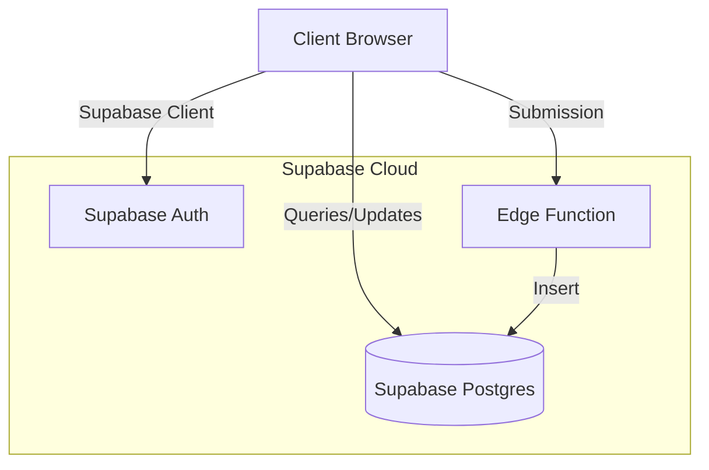

# IMPLEMENTATION_PLAN.md

## 1. Executive Summary
This document outlines the technical plan for transitioning the Solar Energy Website Design prototype from an in-browser (localStorage/sessionStorage) mockup to a production-ready application using Supabase for persistence, authentication, and inquiry management. The plan focuses on minimal disruption, reuse of existing TypeScript DTOs, and leveraging the established schema defined in `docs/cms-schema.md`.

## 2. Existing Codebase Assessment
- **Architecture:** React 19 SPA, Vite 8, Tailwind CSS v4.
- **Persistence:** Currently browser-only (`localStorage` for CMS, `sessionStorage` for quotes).
- **Backend:** None. No network communication, zero environment variables, zero API integrations.
- **Data:** Pure-function calculation engine (`solarCalc.ts`) and static configuration (`solarCalibration.ts`).
- **CMS:** Local `admin` area modifying a single JSON blob. No authentication/authorization.
- **Migration Readiness:** High. `src/lib/cms.ts` provides a clear repository interface. `docs/cms-schema.md` defines the target PostgreSQL schema.

## 3. Current vs. Proposed Architecture
- **Current:** Pure Client-side SPA -> localStorage/sessionStorage.
- **Proposed:** React SPA -> Supabase (Client SDK) -> PostgreSQL + RLS + Edge Functions.
- **Key Change:** Move from browser storage to a centralized database with fine-grained access control.

## 4. System Architecture Diagrams
*(High-level architecture, Auth flow, Data flow, Backend interaction - Mermaid)*

## 5. Supabase Database Design
Aligned with `docs/cms-schema.md` and expanded for dynamic catalog support:
- `admin_users` (FK to auth.users, role-based)
- `pages` (UUID PK, unique slug/path)
- `page_sections` (FK to pages, ordered sections)
- `site_settings` (Key-value store)
- `contact_inquiries` (Status-tracked source: Contact/Quote)
- `solar_packages` (Catalog for Home/Solutions)
- `solar_addons` (Catalog for Solutions)
- *Reserved:* `media_assets`, `activity_logs`.

### Catalog Table Definitions
- `solar_packages`: `id text PK`, `name text not null`, `audience text not null`, `type text not null`, `solar numeric not null`, `inverter numeric not null`, `battery numeric not null`, `panels text not null`, `generation numeric not null`, `price numeric not null`, `includes text[]`, `featured boolean default false`.
- `solar_addons`: `id text PK`, `name text not null`, `spec text not null`, `price numeric not null`.

## 6. Backend Configuration Plan
- **Supabase SDK:** Initialize in `src/lib/supabaseClient.ts`.
- **Environment:** Use `VITE_SUPABASE_URL` and `VITE_SUPABASE_ANON_KEY`.
- **Admin Access:** Supabase Auth + RLS policies on all tables.
- **Edge Function:** Create a `submit-inquiry` function for public form handling (Contact/Quote), bypassing service-role exposure in the browser.

## 7. API Endpoint Inventory
- **Authentication:** Supabase Auth (Sign-in/out).
- **Public:** `POST /functions/v1/submit-inquiry` (Contact/Quote forms).
- **Protected (Admin):**
    - `GET/PUT /rest/v1/pages`
    - `GET/PUT /rest/v1/page_sections`
    - `GET/PATCH /rest/v1/contact_inquiries`

## 8. Data Migration Strategy
| Source Table | Target Table | Transformation | Dependencies |
| --- | --- | --- | --- |
| localStorage `cms` | `pages`/`page_sections` | JSON structure -> Relational rows | Stable page IDs |
| localStorage `settings` | `site_settings` | JSON content -> JSONB row | None |
| sessionStorage `quotes` | `contact_inquiries` | DTO -> Table row | Edge Function |

## 9. Environment and Deployment Configuration
- **Vercel/Hosting:** Retain current SPA rewrite rules in `vercel.json`.
- **Environment:** Add `.env.local` to `.gitignore`. Configure Supabase project URL and keys.
- **CI/CD:** No changes requested to Figma Make deployment; ensure `pnpm run build` works with new env vars.

## 10. Phased Implementation Roadmap
1. **Phase 1: Setup:** Initialize Supabase, define schema, set up RLS.
2. **Phase 2: Authentication:** Configure `/admin` login via Supabase Auth.
3. **Phase 3: Repository Migration:** Refactor `src/lib/cms.ts` to use Supabase SDK instead of localStorage.
4. **Phase 4: Form Integration:** Implement `submit-inquiry` Edge Function; update `quoteService.ts` and `ContactPage.tsx`.
5. **Phase 5: Cleanup:** Remove local persistence code, verify production behavior.

## 11. Testing and Validation Strategy
- **Unit Tests:** Maintain `solarCalc.ts` coverage.
- **Integration Tests:** Verify RLS policies (e.g., public cannot read `contact_inquiries`).
- **Manual Validation:** Admin can see/edit pages; public can submit forms; data persists after reload.

## 12. Risks and Mitigation
- **Risk:** Exposure of database credentials. **Mitigation:** Use ANON key for read-only/authenticated RLS; Edge Functions for protected operations.
- **Risk:** Data loss during migration. **Mitigation:** Export local prototype data via the admin panel before switching production keys.

## 13. Architecture Decisions (ADR)
- **ADR-001:** Keep business logic (calculation engine) client-side to maintain performance and offline-like feel for the calculator.
- **ADR-002:** Store entire quote draft JSONB in `contact_inquiries` to simplify schema.

## 14. Open Questions and Unverified Assumptions
- **Assumption:** Supabase Auth invite flow is sufficient for admin user management.
- **Question:** Do we need to preserve legacy quote history currently in the `sessionStorage` of existing users' browsers? (Recommendation: Treat as ephemeral; don't attempt migration).
